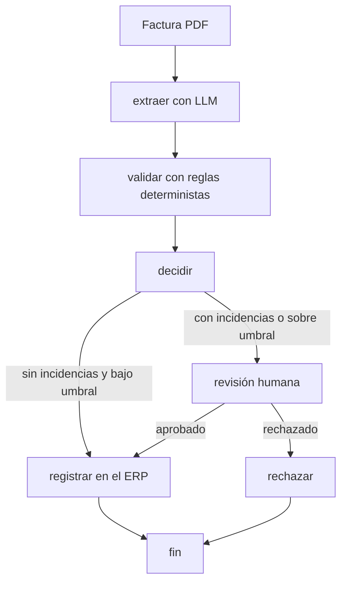
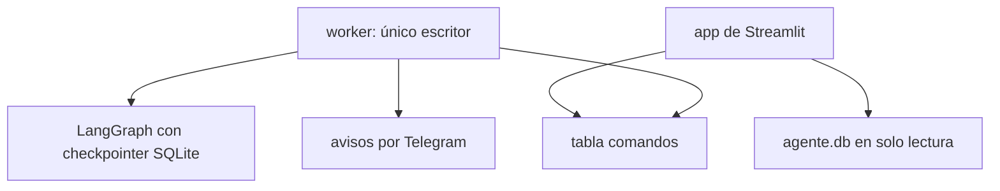

# 🧾 Agente de cuentas por pagar · Logística Ibérica


Agente que lee facturas de proveedor en PDF, las valida contra el ERP de la
empresa y decide entre **registrarlas automáticamente** 📥 o **enviarlas a
revisión humana** 🙋, con aviso al móvil 📱 y panel de aprobación.

Es una demo de portfolio: los datos son simulados y el agente **no paga nada**.
Lo interesante no es que use un modelo de lenguaje, sino *dónde* lo usa: solo
para leer el PDF. Todo lo demás —validación fiscal, aritmética, cruce con el
albarán y decisión— es código determinista y auditable.

---

## 💼 El problema

400 facturas al mes y 15 horas semanales de picado manual. El coste real no es
teclear: es que los errores se detectan tarde. Una cantidad que no coincide con
lo entregado, un CIF con un dígito cambiado o un IBAN distinto al de la ficha son
cosas que un humano revisa mal y un programa revisa siempre igual.

La demo procesa un lote de **20 facturas** en las que hay **exactamente 10
problemas** y comprueba que el agente los encuentra **todos** y no inventa
ninguno:

| Motivo de revisión | Facturas |
|---|---|
| ⚖️ Cantidad facturada ≠ entregada | 2 |
| 🏷️ Concepto facturado ≠ entregado | 1 |
| ➕ Línea facturada que no está en el albarán | 1 |
| ➖ Línea entregada que no está facturada | 1 |
| 🪪 CIF de la factura ≠ CIF del maestro | 2 |
| 💶 Importe por encima del umbral de aprobación (1.000 €) | 3 |
| **Total** | **10** |

Las otras 10 se registran solas. ✅ Cero falsos positivos, cero falsos negativos.

---

## ⚙️ Cómo funciona



Y alrededor del grafo, tres procesos con responsabilidades separadas:



- 🔒 **El worker es el único escritor.** Mueve el grafo, escribe el checkpointer y
  aplica las decisiones.
- 👀 **El panel es de solo lectura.** Abre SQLite con `mode=ro`; su única escritura
  es el `INSERT` en `comandos`. Así no hay dos procesos peleándose por el mismo
  fichero de checkpoints.

---

## 🔍 El detalle que hace que funcione

**El modelo solo extrae; nunca decide.** `gpt-4o-mini` convierte el texto del PDF
en un objeto `Factura` validado por Pydantic (`extra="forbid"`: un campo inventado
no pasa). A partir de ahí:

- 🪪 **Datos fiscales**: CIF, razón social, IBAN y forma de pago contra el maestro
  de proveedores. Un IBAN distinto es la alerta clásica de suplantación.
- 🧮 **Aritmética**: suma de líneas = base imponible, y base + IVA − IRPF = total,
  al céntimo.
- 📦 **Cruce documental**: concepto y cantidad de cada línea contra el albarán
  citado, distinguiendo cantidad, mercancía, línea de más y línea de menos.
- 💶 **Umbral**: por encima de 1.000 €, revisión humana aunque no haya incidencias.

Si la extracción no cuadra consigo misma (la suma de líneas no da la base, que es
el error más frecuente del modelo), se reintenta con el error como feedback y, si
nunca cuadra, se devuelve la última lectura: la validación determinista la manda a
revisión en lugar de perderla.

**Resultados medidos del extractor** (`python evaluar_extraccion.py`):

| Métrica | Valor |
|---|---|
| Facturas extraídas correctamente | 20/20 |
| Precisión por campo | 100 % en los 10 campos |
| Tiempo | 88,9 s el lote · 4,45 s por factura |
| Coste | ~0,0003 $/factura · ~0,01 $ el lote |

Ese coste es el **coste de extracción** (tokens del modelo), que no tiene nada que
ver con el importe de las facturas. Se calcula con los tokens que informa el
proveedor y la tarifa configurada, y se acumula entre reintentos.

---

## 🚀 Arranque rápido

Requisitos: Python 3.12, las dependencias del proyecto y un `.env` en la raíz
con `OPENAI_API_KEY` y las claves `AGENTE_*` (plantilla en `.env.example`).

```bash
python -m pip install -r requirements.txt
python -m pip install -r requirements-dev.txt   # solo para tests y linter

python worker.py            # procesa las 20 facturas (~90 s, ~0,01 $ de API)
python worker.py --vigilar  # aplica las decisiones que se tomen en el panel
streamlit run app.py        # panel en http://localhost:8501
```

✅ **Resultado esperado:** 10 facturas registradas automáticamente y 10 en
revisión, sin falsos positivos. Si `AGENTE_NOTIFICADOR=telegram`, el móvil 📱
recibe un aviso por cada factura que queda pendiente.

♻️ Para repetir la demo desde cero:

```bash
python reset.py --si       # borra el estado generado, no los datos fuente
```

Otros comandos útiles:

| Comando | Para qué |
|---|---|
| `python worker.py --listar` | estado del lote sin abrir el panel |
| `python worker.py --limite 3` | procesa solo tres facturas (pruebas) |
| `python worker.py --reanudar <proceso> --decision aprobado` | decide sin panel |
| `python evaluar_validacion.py` | comprueba que salen exactamente las 10 |
| `python -m pytest -q` | 118 pruebas, sin llamadas a la API |
| `ruff check .` | estilo y errores comunes |

---

## 🔧 Configuración

Todo con prefijo `AGENTE_`, leído de `.env` (en la raíz o en la carpeta del
proyecto) o del entorno:

| Variable | Por defecto | Para qué |
|---|---|---|
| `OPENAI_API_KEY` | — | credencial del modelo |
| `AGENTE_MODELO` | `gpt-4o-mini` | modelo de extracción |
| `AGENTE_UMBRAL_APROBACION` | `1000` | importe a partir del cual hay revisión |
| `AGENTE_NOTIFICADOR` | `consola` | `consola` o `telegram` |
| `AGENTE_TELEGRAM_TOKEN` / `AGENTE_TELEGRAM_CHAT_ID` | — | avisos al móvil |
| `AGENTE_PRECIO_ENTRADA_POR_MILLON` / `..._SALIDA_...` | `0.15` / `0.60` | tarifa para el coste estimado |
| `AGENTE_REINTENTOS_EXTRACCION` | `2` | reintentos si el JSON no valida |

---

## 🗂️ Estructura

```
Estudio_Logistica_Iberica/
├── config.py               # ajustes con pydantic-settings, prefijo AGENTE_
├── worker.py               # procesa el lote, vigila comandos y avisa
├── app.py                  # panel Streamlit (solo lectura)
├── reset.py                # borra el estado derivado entre pruebas
├── gen_factu.py            # genera el lote de facturas y albaranes (dev)
├── evaluar_extraccion.py   # mide la precisión del extractor (dev)
├── evaluar_validacion.py   # comprueba las 10 revisiones esperadas (dev)
├── ruff.toml               # configuración de lint del proyecto
├── requirements.txt        # dependencias de ejecución, con versiones fijadas
├── requirements-dev.txt    # pytest y ruff
├── .env.example            # plantilla de configuración (el .env real no se sube)
├── .gitignore              # secretos, estado generado y documentos de trabajo
├── core/
│   ├── schemas.py          # Pydantic: Factura, Albaran, Proveedor, Incidencia
│   ├── ingest.py           # PDF → texto
│   ├── extraction.py       # LLM + esquema, con reintento y autocontrol aritmético
│   ├── validation.py       # reglas deterministas
│   ├── erp.py              # maestro, albaranes y registro
│   ├── graph.py            # StateGraph con interrupt
│   ├── store.py            # SQLite: procesos, eventos, comandos
│   ├── notify.py           # avisos: consola | Telegram
│   └── metrics.py          # coste de extracción y duración
├── tests/                  # 118 pruebas, sin red
└── datos/                  # "ERP" simulado y estado del agente
```

El "ERP" simulado son tres piezas: `datos/fras/*.pdf` (facturas),
`datos/albaranes/albaranes.json` (entregas) y `datos/maestro_proveedores.json`
(fichas fiscales). El estado del agente —SQLite, checkpoints y registro— es
derivado y se borra con `reset.py`.

---

## 🎯 Decisiones de diseño

- 🧠 **Validación determinista, no LLM.** El modelo es bueno leyendo y malo
  decidiendo: no se le pide una opinión, se le pide un JSON.
- 🔒 **Un único escritor del estado.** Evita bloqueos de SQLite y hace el sistema
  reproducible: dos ejecuciones del mismo lote dan el mismo resultado.
- 📨 **La decisión humana se encola.** El panel inserta en `comandos` y el worker
  reanuda el grafo; el panel nunca toca el checkpointer.
- 💸 **El agente no paga.** Registra la factura con `estado_pago = pendiente`, el
  vencimiento del plazo pactado y el **IBAN de la ficha del proveedor**, nunca el
  impreso en la factura. La remesa la haría tesorería.
- 🧱 **Migraciones idempotentes.** Las columnas de métricas se añaden con
  `ALTER TABLE` sobre una base existente: una demo antigua se actualiza sin
  perder datos.
- 🔁 **Idempotencia.** Ni las notificaciones ni el registro se duplican: se marcan
  con `notificado_en` y por `factura_id`.

---

## ⚠️ Limitaciones conocidas

- 🧪 **Los datos son sintéticos** y los genera `gen_factu.py` de forma
  determinista: son plausibles (IVA, IRPF, vencimientos, formatos españoles), no
  reales.
- 📭 **No hay buzón de correo.** La bandeja es `datos/fras`; en producción el
  worker recogería los adjuntos por IMAP y los dejaría en la misma carpeta.
- 📄 **Si llega una factura sin albarán**, va a revisión: es lo correcto, pero el
  alta del albarán es manual.
- 💰 **El coste es una estimación**, calculada con la tarifa configurada; no es la
  factura de OpenAI.
- 👤 **Un solo operador.** No hay autenticación ni perfiles en el panel: es una
  demo local.
